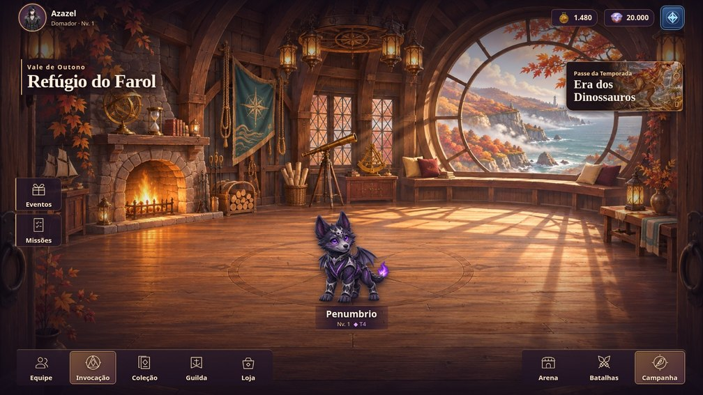
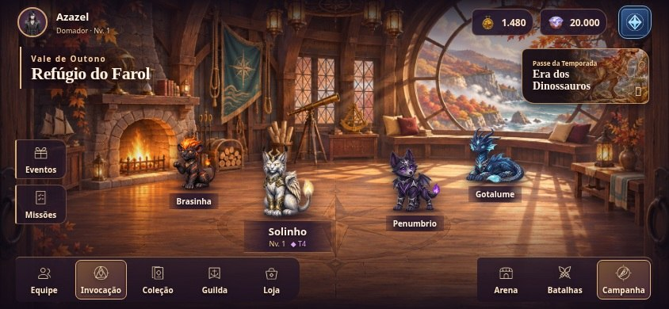
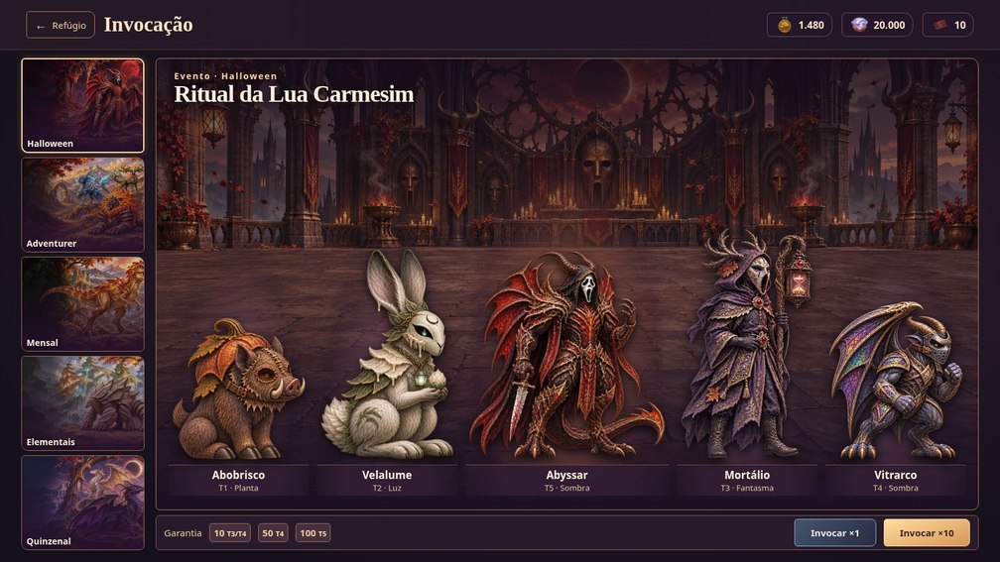

# Confusion Waves · Refúgio do Farol e Invocação

O Refúgio é a primeira cena após carregar ou criar a conta. O cenário foi pintado para dar espaço ao inicial escolhido no centro, ao perfil e às moedas na parte de cima e às entradas de Campanha e Batalhas no rodapé.

## Área de descanso

Use `assets/confusion/interface/descanso-v1/sala.webp` como fundo de 1920 × 1080. Na conta nova, o inicial fica sozinho no centro. Com até quatro membros, use dois pontos à frente e dois ao fundo. O inicial tem altura de até 24% da tela. Os outros três usam aproximadamente 18–21% para dar profundidade. Alinhe patas, cascos ou cauda ao piso e suba as âncoras em telas baixas para os nomes caberem acima do rodapé.

| Posição | Âncora de referência no desktop (x, y) | Altura máxima |
| --- | --- | --- |
| Inicial sozinho | (50%, 77%) | 24% |
| Inicial na equipe | (43%, 77%) | 24% |
| Segundo Onírico | (62%, 76%) | 21% |
| Terceiro Onírico | (29%, 68%) | 18% |
| Quarto Onírico | (74%, 65%) | 18% |

- Perfil e avatar no canto superior esquerdo. Ouro, diamantes e menu rápido à direita.
- Equipe, Invocação, Coleção, Guilda e Loja no rodapé esquerdo. Arena, Batalhas e Campanha no rodapé direito.
- Campanha leva ao último ponto do mapa salvo. Batalhas reúne Torres, Reinos, Arena, Calabouços, Herói × Vilão e Caçadas e Chefes. Os atalhos usam as entradas dos modos já existentes.
- O menu rápido reúne Idle, Mochila, Passe, Montarias, Coleção e Casa. O cartão de temporada vai para o Passe. Eventos e Missões ficam na lateral.
- Preencha o retrato do perfil, o nível, as moedas e o inicial a partir da conta e do save. Use os membros reais da equipe para preencher as posições. Na prévia, o botão do perfil alterna os cinco iniciais e mostra a formação de quatro.

Os ícones transparentes estão em `descanso-v1/icones/`. Os arquivos do inicial representam Penumbrio, Brasinha, Gotalume, Sementil e Solinho em suas formas base.

## Direções e animações dos Oníricos

Os cinco `iniciais/*.webp` são as poses originais de repouso em três quartos. As vistas ortográficas para animação ficam em `iniciais/direcoes/<especie>/` como `frente.webp`, `costas.webp` e `perfil-esquerdo.webp`. Os novos vídeos esperados são frente caminhando, costas em repouso e caminhando, e perfil em repouso. Confira as tomadas de repouso frontal e caminhada lateral disponíveis para aproveitar os ciclos completos.

Para o Flow em 720p, use as duas folhas de dez células. Na referência reduzida para 720p, cada criatura ocupa de 201 a 233 px de altura com essas folhas. A folha de vinte tem cerca de 123 px por criatura em 720p e permite testar os quatro movimentos em uma geração. [Caminhadas](flow/02-caminhadas-10.png) · [Repousos](flow/03-repousos-10.png) · [Folha completa](flow/01-folha-completa-20.png) · [Prompts](flow/Prompts-Flow-Direcoes.txt) · [Grade para recorte](flow/recortes.json)

Ao criar novos Oníricos, projete armaduras, adornos, asas, chifres e marcas em pares ou no eixo central. A cauda tem uma única raiz central e pode balançar. Use a mesma silhueta, cores, escala e linha dos apoios da arte em movimento e parada. Produza um perfil só e espelhe horizontalmente a animação para o lado oposto. Confira os dois lados antes de aprovar a arte, especialmente as peças pequenas e as marcas.

## Invocação

Use `assets/confusion/interface/invocacao-v1/`. A coluna de miniaturas seleciona o banner. O topo mostra o retorno ao Refúgio, os saldos e os tickets da edição. Os controles ×1 e ×10 ficam abaixo da arte, junto dos marcos da edição quando aplicáveis.

| Arte | Uso |
| --- | --- |
| `capas/*.webp` | Cinco capas completas de 1920 × 1080. Use `object-fit: contain` na área principal e mantenha a composição central mesmo em telas mais largas que 16:9. |
| `miniaturas/*.webp` | Seletor lateral de Halloween, Adventurer, Mensal, Elementais e Quinzenal. O recorte na miniatura pode ser ajustado sem alterar a capa que aparece no palco. |
| `palco-halloween.webp`, `palco-adventurer.webp` e `elenco/*.webp` | Cenários e sprites transparentes para a composição de corpo inteiro. O personagem em destaque fica no centro. Alinhe as bases dos sprites e deixe os nomes abaixo. |
| `tickets/*.png` | Ícones com transparência para o saldo de cada edição. |

O palco de Halloween usa o elenco do evento, com Abyssar no centro. O exemplo Adventurer usa Fanalino, Cervomusgo, Cobrabúfalo, Tatuveludo e Xistolim. Use dados reais para elenco, disponibilidade e custos de cada edição. Os nomes cênicos e números das capturas ilustram a composição. Os ativos entram nas rotas de Invocação e no fluxo de revelação existentes.

A prévia foi composta para desktop e celular em paisagem. Mantenha a arte inteira, ajuste o tamanho do elenco pelo espaço que sobra entre o cabeçalho e os controles e deixe o botão de retorno sempre alcançável.
