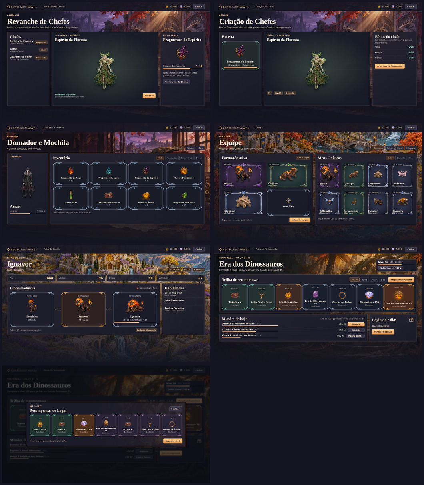

# Confusion Waves · Kit visual dos menus da Região 1

Os arquivos ficam em `assets/confusion/interface/menus-v1/`. Cada fundo WebP tem 1600 × 900 e vem sem texto. Os PNGs de componentes têm transparência. Os valores exibidos nas prévias são exemplos de composição. Na interface, preencha os rótulos e estados com os dados do save.

| Tela | Arquivos | Aplicação |
|---|---|---|
| Revanche e Criação de Chefes | `chefes/fundo.webp`, `chefes/fragmento.png`, `chefes/receita.png` | Reutilize o fundo nas duas telas. Mostre o retrato existente do chefe no painel central, o tempo no seletor e os fragmentos daquele chefe na receita. |
| Domador e Mochila | `mochila/fundo.webp`, `mochila/espaco-item.png` | Use o mesmo encaixe para todos os itens. Desenhe o ícone no centro e mantenha nome e quantidade em texto. |
| Equipe | `equipe/fundo.webp`, `equipe/vaga-vazia.png`, `equipe/vaga-selecionada.png`, `equipe/icone-adicionar.png` | Reutilize os retratos e as cinco molduras de `banner/moldura-1.png` a `banner/moldura-5.png` conforme o tier. Raridade, nível e estrelas têm rótulos próprios. |
| Ficha e Evolução | `ficha/fundo.webp`, `ficha/forma-*.png`, `ficha/conexao.png`, `ficha/sonho-*.png` | Mostre a árvore na ficha do Onírico selecionado. Exiba o elemento, custo, saldo e motivo do bloqueio com texto. O ícone de Aço usa `aco` e o de Sombra usa `trevas`. |
| Passe e Missões | `passe/fundo.webp`, `passe/recompensa-*.png`, `passe/trilha.png`, `passe/ovo-t1.png` a `passe/ovo-t5.png` e demais recompensas | Use a moldura de prêmio final para o Ovo de Dinossauro T5 no nível 100 do Passe. Mostre disponível, resgatado e bloqueado pelo estado do prêmio. |
| Login de 7 dias | `login/fundo.webp`, `login/dia-*.png`, `login/icone-presente.png` | Abra sobre o Passe e diferencie o dia disponível, os dias recebidos e os futuros com moldura e texto. |

O diretório `comum/` inclui painel, botões de destaque e secundário, relógio, cadeado e marca de resgate. Para painéis que mudam de tamanho, preserve as quinas aplicando a moldura em nove fatias ou redesenhando a borda na interface. Use os ícones existentes de ouro, diamante e poções. O fragmento de chefe é uma imagem compartilhada. O nome e o identificador no inventário continuam específicos de cada chefe.

As prévias são de referência para paisagem. No celular, mantenha letras e botões legíveis reagrupando colunas e permitindo rolagem da trilha. Preserve a proporção dos retratos e ovos.

